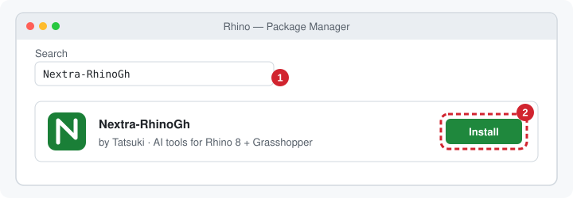
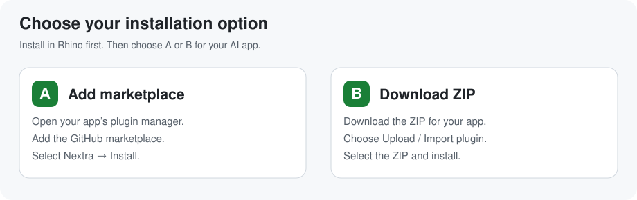
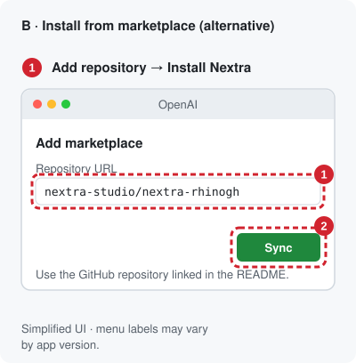
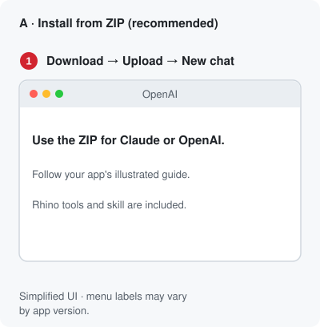
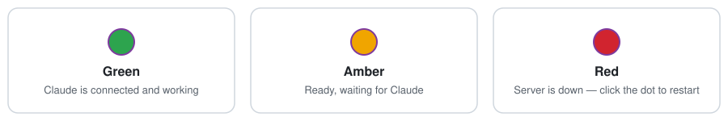

# Nextra for Rhino 8 + Grasshopper

Six token-lean tools let an LLM build and change Rhino models and Grasshopper definitions. It works from ChatGPT desktop / Codex, Claude Desktop, Claude Code, or any MCP client. Replies say exactly what changed, images carry tags the model can point at, and every edit can be undone.

**[Installation guide](#install)** · **[Claude plugin ZIP](https://github.com/Tatsuki0123/nextra-rhinogh/releases/latest/download/nextra-rhinogh-plugin.zip)** · **[GPT plugin ZIP](https://github.com/Tatsuki0123/nextra-rhinogh/releases/latest/download/nextra-rhinogh-gpt-plugin.zip)**

## Install

**Windows · Rhino 8 · [Node.js 18+](https://nodejs.org/en/download).**

### 1. Rhino

Open **PackageManager** in Rhino → search **Nextra-RhinoGh** → **Install** → restart Rhino.



### 2. Your AI app — choose A or B



#### A · Add marketplace

Open your app's **plugin manager** → **Add marketplace** → enter this repository → select **Nextra** → **Install**.

```text
Tatsuki0123/nextra-rhinogh
```

| App | Where to add it | Plugin to install |
|---|---|---|
| **Claude Desktop** | **Customize → Plugins → Add → Add marketplace** | **nextra-rhinogh** |
| **ChatGPT / Codex desktop** | **Create plugin → Add a marketplace** | **Nextra for Rhino** |



#### B · Download and upload ZIP

Click the download for your app, then choose **Upload / Import plugin** in its plugin manager and select the downloaded ZIP.

| App | One-click download | Where to upload it |
|---|---|---|
| **Claude Desktop** | **[⬇ Claude plugin ZIP](https://github.com/Tatsuki0123/nextra-rhinogh/releases/latest/download/nextra-rhinogh-plugin.zip)** | **Customize → Plugins → Add → Upload plugin** |
| **ChatGPT / Codex desktop** | **[⬇ GPT plugin ZIP](https://github.com/Tatsuki0123/nextra-rhinogh/releases/latest/download/nextra-rhinogh-gpt-plugin.zip)** | **Create plugin → Upload plugin archive** |



Both plugin packages include the **Rhino tools and Nextra skill**. Start a new session with Rhino open. In Claude Desktop, use **Cowork** for local Rhino tools. App menu labels vary by version; the diagrams show the workflow.

### Try it

**“Create a simple timber house in Rhino.”**



<details>
<summary>Other AI agents</summary>

**[⬇ General agent kit ZIP](https://github.com/Tatsuki0123/nextra-rhinogh/releases/latest/download/nextra-rhinogh-agent-kit.zip)** — shared skills, MCP server, and workspace configuration. Extract it and open the kit as your agent's workspace. Setup information is in `AGENTS.md`.

</details>

<details>
<summary>Troubleshooting</summary>

| Problem | Fix |
|---|---|
| No Rhino tools | Confirm the plugin is installed, then restart the AI app and start a new session. |
| No status dot in Rhino | Restart Rhino, then enable Nextra with `NextraOn`. |
| Red dot | Click the dot to restart the connection. |
| Multiple Rhino windows | Specify the file, for example “Use house.3dm.” |

</details>

## Tools

| tool | what it does |
|---|---|
| `view` | Rhino or GH canvas image with an 8×8 grid and short handle tags (`r12`, `g4`). Region-first: a crowded view returns per-cell counts, then `focus:'C3:E5'` zooms in. Also shows GH preview geometry in Rhino. |
| `query` | Text, cheapest first. **Rhino:** summary → one line per object with an oriented box → detail → vertices. **GH:** the definition as shorthand. Also searches installed components (with ports), the **API reference** (RhinoCommon, Grasshopper SDK, rhinoscriptsyntax), the docs, your workflows, the script library and status. |
| `run` | Python 3 / C# in Rhino with helpers (`h('r3')`, `q('layer:X')`, `obb()`, `ghdoc()`). Supports patch edits. Replies with the Rhino + GH delta, errors at your own line numbers, and a checkpoint. |
| `gh_edit` | Shorthand diffs: create, modify, wire, group, and component state (dropdowns, on-component toggles, right-click menu, clicks). Also script components, layout/tidy (with group interface relays), and open/save/bake. Definitions can be saved as **`.ghs`**: the same shorthand as readable, diffable text that opens back into an identical canvas. |
| `undo` | Exact revert to any checkpoint (Rhino objects + GH document), independent of Rhino's own undo stack. |
| `memory` | Your preferences and workflows, learned rules (user-approved), mistake log, script library. |

## Benchmarks

**Tokens.** All three MCPs were measured live in the same Rhino. Input and output are counted separately, including schemas and docs. Each result was checked neutrally, and every case gave the same correct model on all three.

**v3** ([test/v3/REPORT.md](test/v3/REPORT.md)) covers 19 cases in one session. They include:
- Rhino frames
- GH towers and fins
- Python and C# components
- Karamba beam, house FE and shell
- data trees, a messy canvas, a freeform canopy, and a 1,224-object model

| one session | Nextra | McNeel Rhino-MCP-Platform | RhinoMCP |
|---|---|---|---|
| tool calls (Python fallbacks) | **43 (0)** | 108 (34) | 96 (32) |
| total tokens | **≈ 16.2k** | ≈ 77.0k (4.8×) | ≈ 237.7k (14.7×) |
| billed input, no cache | **≈ 0.43M** | ≈ 4.12M (9.7×) | ≈ 11.46M (27×) |

The earlier v2 benchmark (office, facade and gridshell) is in [test/v2/REPORT.md](test/v2/REPORT.md): 3.6× and 7.1× fewer tokens than the other two.

**Testing.** A regression suite ([test/regress](test/regress/regress.py)) runs every case in one Rhino session and checks the results: 238 steps, all passing.

<details>
<summary>Maintainers: publish from this public repository</summary>

Source, marketplaces, and release downloads live together in **`Tatsuki0123/nextra-rhinogh`**.

Bump the version in `tools/package.ps1`, `tools/deploy_dev.ps1`, `bridge/manifest.json`, `bridge/server/index.js`, and both `.csproj` files. Then build:

```powershell
./tools/package.ps1
```

Commit the generated `plugin/`, `.claude-plugin/marketplace.json`, and `.agents/plugins/marketplace.json`, and `.gpt-plugin/` along with the source changes. Both marketplaces must list `nextra-rhinogh`. Publish the packages to this repository (replace `<ver>`):

```powershell
yak push dist/nextra-rhinogh-<ver>-rh8_35-win.yak
gh release create v<ver> dist/nextra-rhinogh-plugin.zip dist/nextra-rhinogh-gpt-plugin.zip dist/nextra-rhinogh-agent-kit.zip dist/nextra-rhinogh-<ver>.mcpb dist/nextra-rhinogh-<ver>-rh8_35-win.yak --repo Tatsuki0123/nextra-rhinogh
```

Keep the plugin ZIP filenames stable so the download links above keep working. Regenerate illustrations with `python tools/make_install_images.py`.

</details>

## Your own instructions

The plug-in creates a folder at first start, `%APPDATA%\Nextra\user`; the Rhino command `NextraFolder` opens it. It holds:

| file / folder | what the AI does with it |
|---|---|
| `preferences.md` | Read at the start of every session. |
| `workflows/<name>.md` | Each starts with a `when:` line; the AI opens the one matching your request. |
| `plugins/<Category>.md` | Rules attached automatically when that plug-in's components are used. |
| `scripts/` | Your scripts, available to `run`. |

The folder works however the skill is installed, including as a zip uploaded to claude.ai, because the plug-in serves it through the tools. Plug-in updates never touch it. The README in the folder explains how to write each file.

**Config** is in `%APPDATA%/Nextra/config.json`:

| key | meaning |
|---|---|
| `port` | server port |
| `enabled` | start the server with Rhino |
| `plugin_docs` | `auto`, `hint` or `off` |
| `library_dirs` | extra script folders |
| `user_dir` | location of your folder |
| `memory_dir` | location of the AI's memory |
| `auto_dismiss` | dialog titles to close automatically |
| `capture_copy_dir` | extra copy location for captured images |

## Repository

The folder names serve different roles:

| Folder | Purpose |
|---|---|
| `.claude-plugin/` | Claude's native marketplace catalog. |
| `.gpt-plugin/` | OpenAI metadata grouped for maintainers; generated alongside the native files. |
| `.agents/` | Shared agent resources. OpenAI also discovers `.agents/plugins/marketplace.json` here. |
| `plugin/nextra-rhinogh/.codex-plugin/` | OpenAI's native plugin manifest inside the installable package. |
| `.codex/config.toml` | Optional local Codex workspace configuration for MCP. This is separate from a plugin manifest. |

`.gpt-plugin` is an organization convention for this repository. The recognized `.agents/plugins` and `.codex-plugin` paths stay in place for compatibility. [OpenAI package format](https://developers.openai.com/plugins/build/plugins).


```
src/Nextra.Host     .rhp: 127.0.0.1 server (token), UI-thread dispatcher with timeouts + late results, dialog probe/dismiss, status dots, engine hot-reload
src/Nextra.Engine   all Rhino/GH logic (hot-reloaded on rebuild): tools, shorthand parser/builder/writer, layout, vision, checkpoints, memory, API reference, user folder
bridge/             MCP stdio bridge (zero-dependency Node) + .mcpb manifest
skill/nextra/       SKILL.md, shorthand.md, workflows.md, api/*, plugins/<Category>.md (plug-in guides, auto-attached)
plugin/             generated by tools/make_plugin.py: one plug-in (bridge + skill) for Claude Code and Codex / ChatGPT desktop
.claude-plugin/     Claude marketplace catalog
.gpt-plugin/        OpenAI authoring metadata (generated; native compatibility files are retained)
.agents/            shared agent resources + native OpenAI marketplace catalog
docs/img/           README images (install pictures: tools/make_install_images.py)
tools/              build.py, deploy_dev.ps1 (dev install with hot reload), package.ps1 (yak + mcpb + skill zip + plugin/), nx.py (test client), mcp_http.py
test/               v1/ = first round (cases 01-16), v2/ = detailed benchmark, v3/ = all cases on three systems, regress/ = full regression suite
dev/                developer guide, original plan, build checklist, reference code (information only, not part of the skill)
```

## Develop

1. Run `powershell tools/deploy_dev.ps1` once, with Rhino closed.
2. Start Rhino.
3. Edit the engine code, then run `python tools/build.py`. The next call uses the new engine; no Rhino restart is needed. Host changes do need a restart.
4. Try calls with `python tools/nx.py query '{}'`, and check everything with `python test/regress/regress.py`.

See [dev/](dev/README.md) for the full developer guide.

## License

[Apache License 2.0](LICENSE). Free to use, including commercially. Keep the copyright and license notice ([NOTICE](NOTICE)) and mark any changes you make. The license also grants a patent right to use the code.
