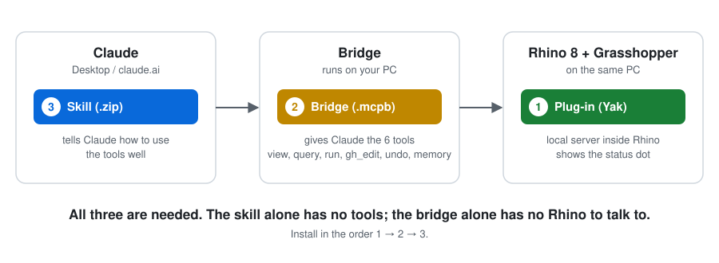
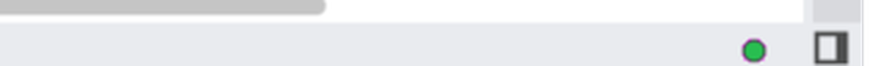
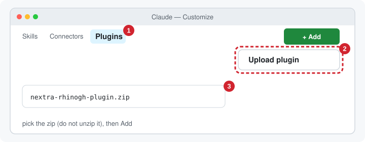
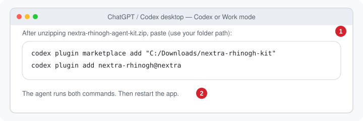
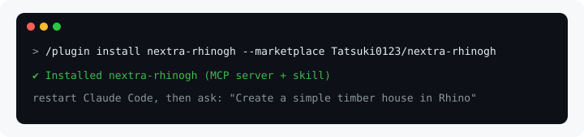

# Nextra for Rhino 8 + Grasshopper

Six token-lean tools let an LLM build and change Rhino models and Grasshopper definitions. It works from Claude Code, Claude Desktop or any MCP client. Replies say exactly what changed, images carry tags the model can point at, and every edit can be undone.

| tool | what it does |
|---|---|
| `view` | Rhino or GH canvas image with an 8×8 grid and short handle tags (`r12`, `g4`). Region-first: a crowded view returns per-cell counts, then `focus:'C3:E5'` zooms in. Also shows GH preview geometry in Rhino. |
| `query` | Text, cheapest first. **Rhino:** summary → one line per object with an oriented box → detail → vertices. **GH:** the definition as shorthand. Also searches installed components (with ports), the **API reference** (RhinoCommon, Grasshopper SDK, rhinoscriptsyntax), the docs, your workflows, the script library and status. |
| `run` | Python 3 / C# in Rhino with helpers (`h('r3')`, `q('layer:X')`, `obb()`, `ghdoc()`). Supports patch edits. Replies with the Rhino + GH delta, errors at your own line numbers, and a checkpoint. |
| `gh_edit` | Shorthand diffs: create, modify, wire, group, and component state (dropdowns, on-component toggles, right-click menu, clicks). Also script components, layout/tidy (with group interface relays), and open/save/bake. Definitions can be saved as **`.ghs`**: the same shorthand as readable, diffable text that opens back into an identical canvas. |
| `undo` | Exact revert to any checkpoint (Rhino objects + GH document), independent of Rhino's own undo stack. |
| `memory` | Your preferences and workflows, learned rules (user-approved), mistake log, script library. |

**Tokens.** All three MCPs were measured live in the same Rhino. Input and output are counted separately, including schemas and docs. Each result was checked neutrally, and every case gave the same correct model on all three.

**v3** ([test/v3/REPORT.md](test/v3/REPORT.md)) covers 19 cases in one session. They include:
- Rhino frames
- GH towers and fins
- Python and C# components
- Karamba beam, house FE and shell
- data trees, a messy canvas, a freeform canopy, and a 1,224-object model

| one session | Nextra | McNeel Rhino-MCP-Platform | RhinoMCP |
|---|---|---|---|
| tool calls (Python fallbacks) | **43 (0)** | 108 (34) | 96 (32) |
| total tokens | **≈ 16.2k** | ≈ 77.0k (4.8×) | ≈ 237.7k (14.7×) |
| billed input, no cache | **≈ 0.43M** | ≈ 4.12M (9.7×) | ≈ 11.46M (27×) |

The earlier v2 benchmark (office, facade and gridshell) is in [test/v2/REPORT.md](test/v2/REPORT.md): 3.6× and 7.1× fewer tokens than the other two.

**Testing.** A regression suite ([test/regress](test/regress/regress.py)) runs every case in one Rhino session and checks the results: 238 steps, all passing.

## Install

Windows · Rhino 8 · Node 18+ · one AI app. Two steps:



### 1 · Rhino plug-in

In Rhino type **`PackageManager`**, search **`Nextra-RhinoGh`**, click **Install**, then **restart Rhino**.


A dot in the bottom-right corner of Rhino means it works:




### 2 · Download from the [latest release](https://github.com/Tatsuki0123/nextra-rhinogh/releases/latest)

<details open>
<summary><b>Claude Desktop</b> → <code>nextra-rhinogh-plugin.zip</code></summary>

**Customize → Plugins → + Add → Upload plugin** → pick the zip (don't unzip it).



Use it in a **Cowork** session. Plain *chat* can't start local tools: for chat, double-click `nextra-rhinogh-<version>.mcpb` from the same release instead.

</details>

<details open>
<summary><b>ChatGPT / Codex desktop</b> → <code>nextra-rhinogh-agent-kit.zip</code></summary>

This app has no "upload a zip" button, so unzip it anywhere, switch to **Codex** or **Work** mode and paste (with your folder path). Then restart the app.

```
Run: codex plugin marketplace add C:/Users/you/nextra-rhinogh-kit
then: codex plugin add nextra-rhinogh@nextra
```



</details>

<details>
<summary><b>Claude Code</b></summary>

```
/plugin install nextra-rhinogh --marketplace Tatsuki0123/nextra-rhinogh
```



</details>

<details>
<summary><b>Any other agent</b> (Cursor, Cline, Gemini CLI, …) → <code>nextra-rhinogh-agent-kit.zip</code></summary>

Unzip it and **open the folder as the agent's workspace**. It is one folder with the skill and the MCP server inside:

```
nextra-rhinogh-kit/
├─ AGENTS.md          ← the agent reads this first: what it is and how to connect
├─ server/index.js    ← the tools (MCP server, Node, no dependencies)
├─ skills/nextra-rhinogh/SKILL.md   ← the skill (also under .agents/ and .claude/)
├─ .mcp.json          ← Claude Code picks the server up from here
└─ .codex/config.toml ← Codex picks the server up from here
```

If your agent doesn't read those files, register the server by hand: command `node`, argument `<folder>/server/index.js`. Then tell it to read `AGENTS.md`.

</details>

### Try it

With Rhino open, ask: ***"Create a simple timber house in Rhino."*** The dot turns green while the AI works.

### Troubleshooting

| You see | Do |
|---|---|
| AI says "Nextra isn't connected" / no Rhino tools | Step 2 is missing, or Claude Desktop is in plain chat (use Cowork or the `.mcpb`). Restart the app after installing. |
| `Unknown command: NextraOn` | Restart Rhino. Still missing: `PlugInManager` → **Nextra.Host** → right-click **Load**. |
| `Blocking plug-in Nextra.Host` | Close **all** Rhino windows, start Rhino again. |
| No dot / red dot | Type `NextraOn` / click the dot. |
| Several Rhino windows | Tell the AI which file, e.g. *"use house.3dm"*. |

*The app pictures are simplified drawings; labels can differ slightly between app versions.*

<details>
<summary>Maintainers: making a release</summary>

Bump the version in `tools/package.ps1`, `tools/deploy_dev.ps1`, `bridge/manifest.json`, `bridge/server/index.js` and both `.csproj` files, then:

```
tools/package.ps1          # .yak, plugin zip, agent-kit zip, .mcpb (and the plugin/ folder)
yak push dist/nextra-rhinogh-<ver>-rh8_35-win.yak
gh release create v<ver> dist/nextra-rhinogh-plugin.zip dist/nextra-rhinogh-agent-kit.zip dist/nextra-rhinogh-<ver>.mcpb dist/nextra-rhinogh-<ver>-rh8_35-win.yak
```

Commit `plugin/`, `.claude-plugin/` and `.agents/plugins/`: the GitHub repo is also a marketplace. Images: `python tools/make_install_images.py`.

</details>

## Your own instructions

The plug-in creates a folder at first start, `%APPDATA%\Nextra\user`; the Rhino command `NextraFolder` opens it. It holds:

| file / folder | what the AI does with it |
|---|---|
| `preferences.md` | Read at the start of every session. |
| `workflows/<name>.md` | Each starts with a `when:` line; the AI opens the one matching your request. |
| `plugins/<Category>.md` | Rules attached automatically when that plug-in's components are used. |
| `scripts/` | Your scripts, available to `run`. |

The folder works however the skill is installed, including as a zip uploaded to claude.ai, because the plug-in serves it through the tools. Plug-in updates never touch it. The README in the folder explains how to write each file.

**Config** is in `%APPDATA%/Nextra/config.json`:

| key | meaning |
|---|---|
| `port` | server port |
| `enabled` | start the server with Rhino |
| `plugin_docs` | `auto`, `hint` or `off` |
| `library_dirs` | extra script folders |
| `user_dir` | location of your folder |
| `memory_dir` | location of the AI's memory |
| `auto_dismiss` | dialog titles to close automatically |
| `capture_copy_dir` | extra copy location for captured images |

## Repository

```
src/Nextra.Host     .rhp: 127.0.0.1 server (token), UI-thread dispatcher with timeouts + late results, dialog probe/dismiss, status dots, engine hot-reload
src/Nextra.Engine   all Rhino/GH logic (hot-reloaded on rebuild): tools, shorthand parser/builder/writer, layout, vision, checkpoints, memory, API reference, user folder
bridge/             MCP stdio bridge (zero-dependency Node) + .mcpb manifest
skill/nextra/       SKILL.md, shorthand.md, workflows.md, api/*, plugins/<Category>.md (plug-in guides, auto-attached)
plugin/             generated by tools/make_plugin.py: one plug-in (bridge + skill) for Claude Code and Codex / ChatGPT desktop
.claude-plugin/     Claude Code marketplace (this repo);  .agents/plugins/ = Codex / ChatGPT marketplace
docs/img/           README images (install pictures: tools/make_install_images.py)
tools/              build.py, deploy_dev.ps1 (dev install with hot reload), package.ps1 (yak + mcpb + skill zip + plugin/), nx.py (test client), mcp_http.py
test/               v1/ = first round (cases 01-16), v2/ = detailed benchmark, v3/ = all cases on three systems, regress/ = full regression suite
dev/                developer guide, original plan, build checklist, reference code (information only, not part of the skill)
```

## Develop

1. Run `powershell tools/deploy_dev.ps1` once, with Rhino closed.
2. Start Rhino.
3. Edit the engine code, then run `python tools/build.py`. The next call uses the new engine; no Rhino restart is needed. Host changes do need a restart.
4. Try calls with `python tools/nx.py query '{}'`, and check everything with `python test/regress/regress.py`.

See [dev/](dev/README.md) for the full developer guide.

## License

[Apache License 2.0](LICENSE). Free to use, including commercially. Keep the copyright and license notice ([NOTICE](NOTICE)) and mark any changes you make. The license also grants a patent right to use the code.
