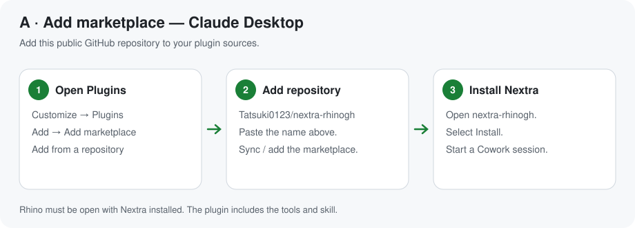
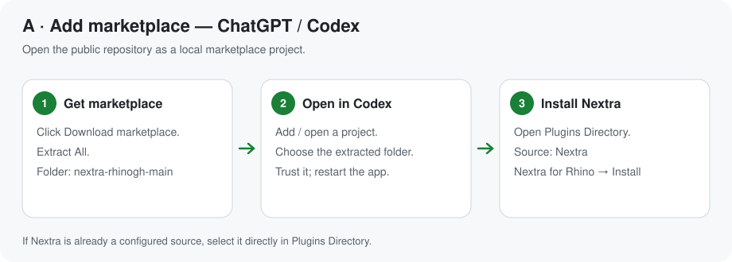
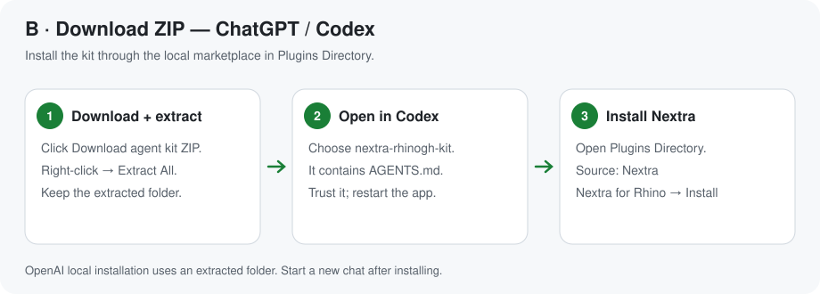

# Nextra for Rhino 8 + Grasshopper

Six token-lean tools let an LLM build and change Rhino models and Grasshopper definitions. It works from ChatGPT desktop / Codex, Claude Desktop, Claude Code, or any MCP client. Replies say exactly what changed, images carry tags the model can point at, and every edit can be undone.

**[Installation guide](#install)** · **[Claude plugin ZIP](https://github.com/Tatsuki0123/nextra-rhinogh/releases/latest/download/nextra-rhinogh-plugin.zip)** · **[ChatGPT / Codex ZIP](https://github.com/Tatsuki0123/nextra-rhinogh/releases/latest/download/nextra-rhinogh-agent-kit.zip)**

| tool | what it does |
|---|---|
| `view` | Rhino or GH canvas image with an 8×8 grid and short handle tags (`r12`, `g4`). Region-first: a crowded view returns per-cell counts, then `focus:'C3:E5'` zooms in. Also shows GH preview geometry in Rhino. |
| `query` | Text, cheapest first. **Rhino:** summary → one line per object with an oriented box → detail → vertices. **GH:** the definition as shorthand. Also searches installed components (with ports), the **API reference** (RhinoCommon, Grasshopper SDK, rhinoscriptsyntax), the docs, your workflows, the script library and status. |
| `run` | Python 3 / C# in Rhino with helpers (`h('r3')`, `q('layer:X')`, `obb()`, `ghdoc()`). Supports patch edits. Replies with the Rhino + GH delta, errors at your own line numbers, and a checkpoint. |
| `gh_edit` | Shorthand diffs: create, modify, wire, group, and component state (dropdowns, on-component toggles, right-click menu, clicks). Also script components, layout/tidy (with group interface relays), and open/save/bake. Definitions can be saved as **`.ghs`**: the same shorthand as readable, diffable text that opens back into an identical canvas. |
| `undo` | Exact revert to any checkpoint (Rhino objects + GH document), independent of Rhino's own undo stack. |
| `memory` | Your preferences and workflows, learned rules (user-approved), mistake log, script library. |

**Tokens.** All three MCPs were measured live in the same Rhino. Input and output are counted separately, including schemas and docs. Each result was checked neutrally, and every case gave the same correct model on all three.

**v3** ([test/v3/REPORT.md](test/v3/REPORT.md)) covers 19 cases in one session. They include:
- Rhino frames
- GH towers and fins
- Python and C# components
- Karamba beam, house FE and shell
- data trees, a messy canvas, a freeform canopy, and a 1,224-object model

| one session | Nextra | McNeel Rhino-MCP-Platform | RhinoMCP |
|---|---|---|---|
| tool calls (Python fallbacks) | **43 (0)** | 108 (34) | 96 (32) |
| total tokens | **≈ 16.2k** | ≈ 77.0k (4.8×) | ≈ 237.7k (14.7×) |
| billed input, no cache | **≈ 0.43M** | ≈ 4.12M (9.7×) | ≈ 11.46M (27×) |

The earlier v2 benchmark (office, facade and gridshell) is in [test/v2/REPORT.md](test/v2/REPORT.md): 3.6× and 7.1× fewer tokens than the other two.

**Testing.** A regression suite ([test/regress](test/regress/regress.py)) runs every case in one Rhino session and checks the results: 238 steps, all passing.

## Install

**Windows · Rhino 8 · Node.js 18+ · your preferred AI desktop app.**

Install the Rhino plug-in once, then choose **one** installation method for your AI app below. Each AI plugin includes both the tools and the skill.

### 1. Install in Rhino

1. In Rhino, run **`PackageManager`**.
2. Search **`Nextra-RhinoGh`**, click **Install**, and restart Rhino.
3. Look for the status dot in the bottom-right corner.


### 2. Choose one option


| Option | Claude Desktop / Cowork | ChatGPT desktop / Codex |
|---|---|---|
| **A · Add marketplace** | Add the GitHub repository in Plugins. | Open the downloaded marketplace as a Codex project, then install from Plugins Directory. |
| **B · Download ZIP** | **[Download plugin ZIP](https://github.com/Tatsuki0123/nextra-rhinogh/releases/latest/download/nextra-rhinogh-plugin.zip)** → upload it. | **[Download agent kit ZIP](https://github.com/Tatsuki0123/nextra-rhinogh/releases/latest/download/nextra-rhinogh-agent-kit.zip)** → extract and open it. |

Both options include the **Rhino tools + Nextra skill**. Follow the steps for your app below.

#### Option A · Add marketplace

**Claude Desktop**

1. **Customize → Plugins → Add → Add marketplace → Add from a repository**.
2. Paste **`Tatsuki0123/nextra-rhinogh`** and sync/add it.
3. Open **nextra-rhinogh** → **Install**. Start a new **Cowork** session.



**ChatGPT desktop / Codex**

1. **[Download the marketplace](https://github.com/Tatsuki0123/nextra-rhinogh/archive/refs/heads/main.zip)** → right-click the ZIP → **Extract All**.
2. In **Codex**, open the extracted **`nextra-rhinogh-main`** folder as a project and trust it when prompted.
3. Restart the desktop app. Open **Plugins Directory** → choose the **Nextra** source → **Nextra for Rhino** → **Install**.

If the Nextra source is already available in your Plugins Directory, go straight to step 3.



#### Option B · Download ZIP

**Claude Desktop — upload the ZIP**

### [⬇ Download Claude plugin ZIP](https://github.com/Tatsuki0123/nextra-rhinogh/releases/latest/download/nextra-rhinogh-plugin.zip)

1. **Customize → Plugins → Add → Upload plugin**.
2. Select **`nextra-rhinogh-plugin.zip`** and complete the installation. Keep the ZIP zipped.
3. Start a new **Cowork** session.


**ChatGPT desktop / Codex — open the extracted kit**

### [⬇ Download ChatGPT / Codex ZIP](https://github.com/Tatsuki0123/nextra-rhinogh/releases/latest/download/nextra-rhinogh-agent-kit.zip)

1. Right-click the downloaded ZIP → **Extract All**.
2. In **Codex**, open **`nextra-rhinogh-kit`** as a project: choose the folder containing **`AGENTS.md`**. Trust it when prompted.
3. Restart the desktop app. Open **Plugins Directory** → **Nextra** → **Nextra for Rhino** → **Install**.

OpenAI's documented local installation uses an extracted folder; it does not document a personal ZIP-upload button for this local plugin.



Keep the extracted folder on your computer. After either option, start a new chat with Rhino open. Use **Cowork** for Claude's local Rhino tools.

Installation references: [OpenAI local marketplace setup](https://developers.openai.com/plugins/build/plugins) · [Claude marketplace and ZIP setup](https://support.claude.com/en/articles/13837440-use-plugins-in-claude). The diagrams illustrate the steps; app labels may vary by version.

### 3. Try it

Keep Rhino open and ask: **“Create a simple timber house in Rhino.”** The dot turns green when the AI connects.

### Troubleshooting

| You see | What to do |
|---|---|
| Node.js is missing | Install [Node.js](https://nodejs.org/en/download), then restart the desktop app. |
| No Rhino tools in the AI app | Finish step 2, restart the app, and start a new session. In Claude, use Cowork for the local Rhino tools. |
| `Unknown command: NextraOn` | Restart Rhino. If still missing: **`PlugInManager` → Nextra.Host → Load**. |
| `Blocking plug-in Nextra.Host` | Close all Rhino windows, then start Rhino again. |
| No dot / red dot | Run **`NextraOn`** / click the dot. |
| Several Rhino windows | Tell the AI which file to use, for example **“Use house.3dm.”** |

The app pictures are simplified illustrations; labels and plugin availability can vary by app version and workspace settings. Installation references: [OpenAI plugin setup](https://developers.openai.com/plugins/build/plugins) · [Claude plugin setup](https://support.claude.com/en/articles/13837440-use-plugins-in-claude).

<details>
<summary>Maintainers: publish from this public repository</summary>

Source, marketplaces, and release downloads live together in **`Tatsuki0123/nextra-rhinogh`**.

Bump the version in `tools/package.ps1`, `tools/deploy_dev.ps1`, `bridge/manifest.json`, `bridge/server/index.js`, and both `.csproj` files. Then build:

```powershell
./tools/package.ps1
```

Commit the generated `plugin/`, `.claude-plugin/marketplace.json`, and `.agents/plugins/marketplace.json` along with the source changes. Both marketplaces must list `nextra-rhinogh`. Publish the packages to this repository (replace `<ver>`):

```powershell
yak push dist/nextra-rhinogh-<ver>-rh8_35-win.yak
gh release create v<ver> dist/nextra-rhinogh-plugin.zip dist/nextra-rhinogh-agent-kit.zip dist/nextra-rhinogh-<ver>.mcpb dist/nextra-rhinogh-<ver>-rh8_35-win.yak --repo Tatsuki0123/nextra-rhinogh
```

Keep the two ZIP filenames stable so the download links above keep working. Regenerate illustrations with `python tools/make_install_images.py`.

</details>

## Your own instructions

The plug-in creates a folder at first start, `%APPDATA%\Nextra\user`; the Rhino command `NextraFolder` opens it. It holds:

| file / folder | what the AI does with it |
|---|---|
| `preferences.md` | Read at the start of every session. |
| `workflows/<name>.md` | Each starts with a `when:` line; the AI opens the one matching your request. |
| `plugins/<Category>.md` | Rules attached automatically when that plug-in's components are used. |
| `scripts/` | Your scripts, available to `run`. |

The folder works however the skill is installed, including as a zip uploaded to claude.ai, because the plug-in serves it through the tools. Plug-in updates never touch it. The README in the folder explains how to write each file.

**Config** is in `%APPDATA%/Nextra/config.json`:

| key | meaning |
|---|---|
| `port` | server port |
| `enabled` | start the server with Rhino |
| `plugin_docs` | `auto`, `hint` or `off` |
| `library_dirs` | extra script folders |
| `user_dir` | location of your folder |
| `memory_dir` | location of the AI's memory |
| `auto_dismiss` | dialog titles to close automatically |
| `capture_copy_dir` | extra copy location for captured images |

## Repository

```
src/Nextra.Host     .rhp: 127.0.0.1 server (token), UI-thread dispatcher with timeouts + late results, dialog probe/dismiss, status dots, engine hot-reload
src/Nextra.Engine   all Rhino/GH logic (hot-reloaded on rebuild): tools, shorthand parser/builder/writer, layout, vision, checkpoints, memory, API reference, user folder
bridge/             MCP stdio bridge (zero-dependency Node) + .mcpb manifest
skill/nextra/       SKILL.md, shorthand.md, workflows.md, api/*, plugins/<Category>.md (plug-in guides, auto-attached)
plugin/             generated by tools/make_plugin.py: one plug-in (bridge + skill) for Claude Code and Codex / ChatGPT desktop
.claude-plugin/     Claude Code marketplace (this repo);  .agents/plugins/ = Codex / ChatGPT marketplace
docs/img/           README images (install pictures: tools/make_install_images.py)
tools/              build.py, deploy_dev.ps1 (dev install with hot reload), package.ps1 (yak + mcpb + skill zip + plugin/), nx.py (test client), mcp_http.py
test/               v1/ = first round (cases 01-16), v2/ = detailed benchmark, v3/ = all cases on three systems, regress/ = full regression suite
dev/                developer guide, original plan, build checklist, reference code (information only, not part of the skill)
```

## Develop

1. Run `powershell tools/deploy_dev.ps1` once, with Rhino closed.
2. Start Rhino.
3. Edit the engine code, then run `python tools/build.py`. The next call uses the new engine; no Rhino restart is needed. Host changes do need a restart.
4. Try calls with `python tools/nx.py query '{}'`, and check everything with `python test/regress/regress.py`.

See [dev/](dev/README.md) for the full developer guide.

## License

[Apache License 2.0](LICENSE). Free to use, including commercially. Keep the copyright and license notice ([NOTICE](NOTICE)) and mark any changes you make. The license also grants a patent right to use the code.
