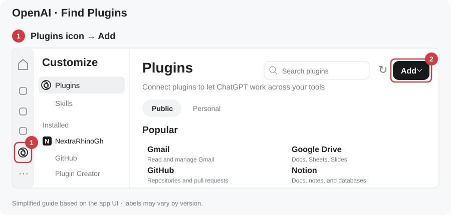
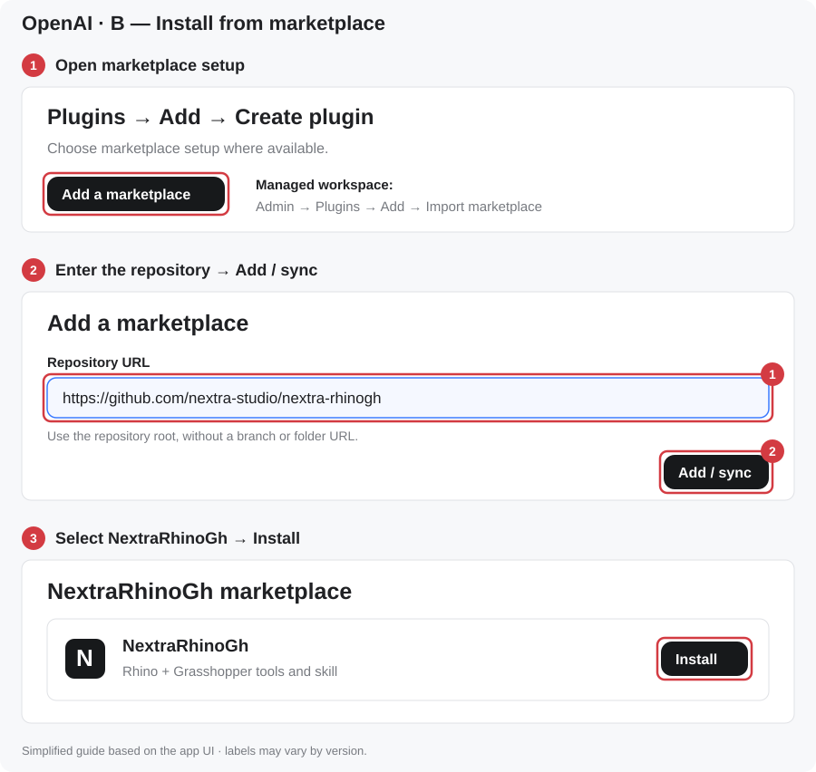
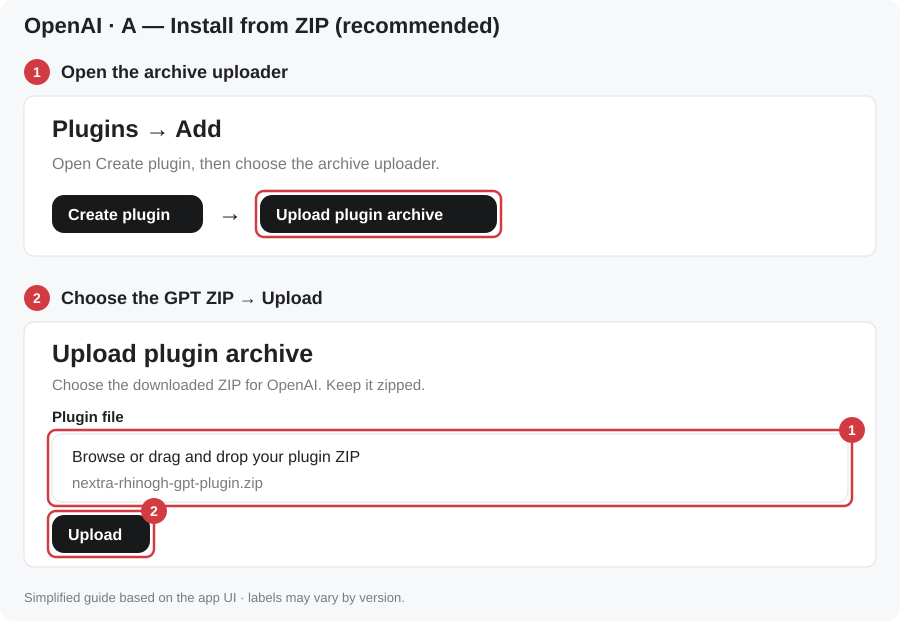
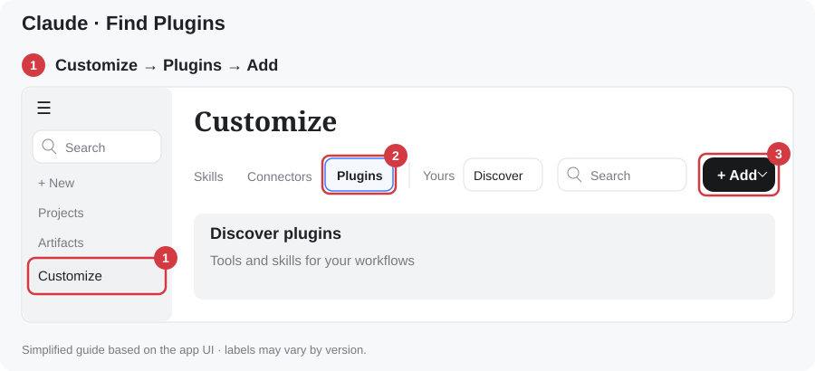
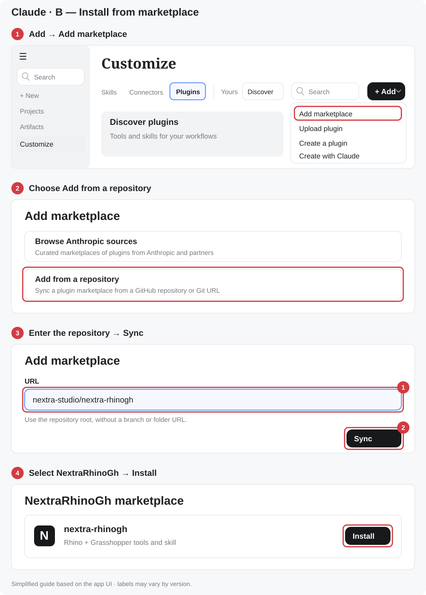
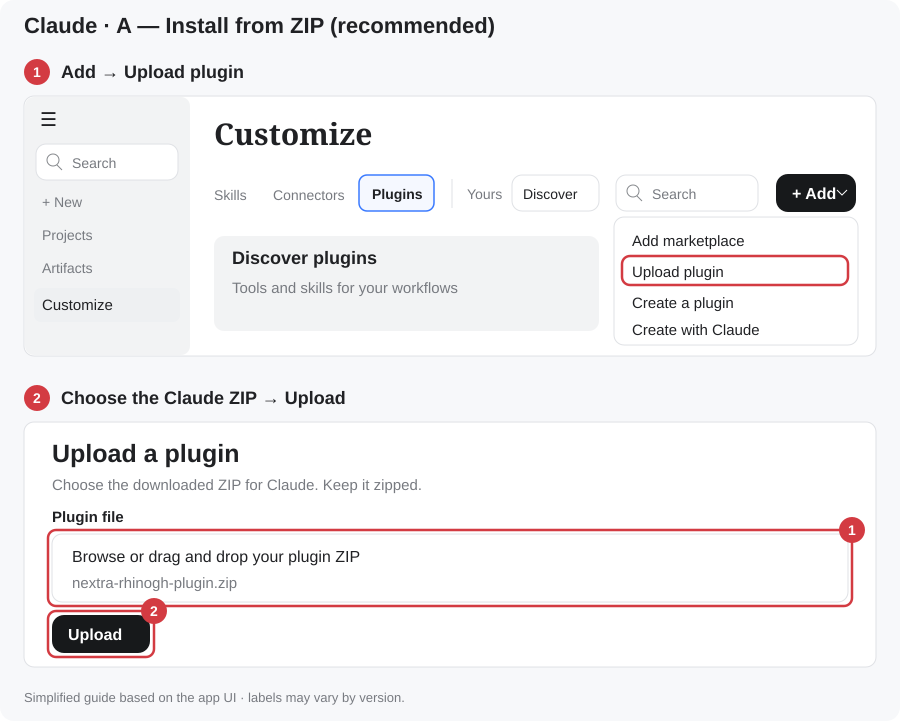

# NextraRhinoGh — Rhino 8 + Grasshopper

Six token-lean tools let an LLM build and change Rhino models and Grasshopper definitions. It works from ChatGPT desktop / Codex, Claude Desktop, Claude Code, or any MCP client. Replies say what changed, images carry tags the model can point at, and model and definition edits receive undo checkpoints.

**[Install in about 3 minutes](#install)** · **[Download Setup (Node.js)](https://github.com/nextra-studio/nextra-rhinogh/releases/latest/download/NextraRhinoGh-Setup.bat)** · **[Download Claude ZIP](https://github.com/nextra-studio/nextra-rhinogh/releases/latest/download/nextra-rhinogh-plugin.zip)** · **[Download ChatGPT/Codex ZIP](https://github.com/nextra-studio/nextra-rhinogh/releases/latest/download/nextra-rhinogh-gpt-plugin.zip)**

## Install

**About 3 minutes, no hassle:** run one setup file, install from Rhino’s PackageManager, add the plugin to your AI app. Nothing to host, no extra subscription.

**Windows · Rhino 8 · Node.js 18 or newer.**

### 1. Node.js

The AI apps start the Rhino connection with Node.js. Setup installs it for you:

1. **[Download NextraRhinoGh-Setup.bat](https://github.com/nextra-studio/nextra-rhinogh/releases/latest/download/NextraRhinoGh-Setup.bat)**.
2. Double-click it. If your browser asks, choose **Keep**. If Windows asks whether to run it, click **Run** (or **More info → Run anyway**). Allow the Node.js installer when Windows asks.
3. Restart your AI app when it finishes.

Setup does nothing if Node.js 18 or newer is already installed. It installs Node.js LTS with winget, or downloads the official installer from nodejs.org if winget is missing.

**If setup cannot install it:** download the **LTS** Windows Installer (.msi) from **<https://nodejs.org/en/download>**, run it with the default options, then restart your AI app.

### 2. Rhino

Open **PackageManager** in Rhino → search **Nextra-RhinoGh** → **Install** → restart Rhino.


### 3. Your AI app

Choose your AI app below. For ChatGPT/Codex and Claude, **install from this GitHub marketplace** for the easiest update path, or **download the ZIP**. These are two ways to install the same plugin; choose one.

```text
https://github.com/nextra-studio/nextra-rhinogh
```

The pictures are simplified guides based on the app menus. Labels can vary by version.

<details open>
<summary><strong>ChatGPT desktop (work)</strong></summary>

**Find Plugins:** click the **Plugins icon** in the far-left navigation rail (highlighted below), then click **Add** at the top right.



<details open>
<summary><strong>Install from marketplace (recommended)</strong></summary>

1. Open **Add → Create plugin → Add a marketplace** where available.
2. In **Add plugin marketplace**, fill in the fields exactly as follows, then click **Add marketplace**:

   | Field | Enter |
   |---|---|
   | **Source** | `https://github.com/nextra-studio/nextra-rhinogh` |
   | **Git ref** | `main` |
   | **Sparse paths** | Leave empty |

   Leave **Sparse paths** empty so the marketplace catalog and the plugin folder are both included.

3. Open **NextraRhinoGh**, select **NextraRhinoGh**, and click **Install** (or **+**).



If your desktop app does not show **Add a marketplace**, run `codex plugin marketplace add nextra-studio/nextra-rhinogh` in a terminal, restart the desktop app, then install **NextraRhinoGh** from that marketplace in the Plugins Directory. [OpenAI marketplace guide](https://developers.openai.com/plugins/build/plugins).

</details>

<details>
<summary><strong>Download and upload ZIP</strong></summary>

1. **[Download the ChatGPT/Codex plugin ZIP](https://github.com/nextra-studio/nextra-rhinogh/releases/latest/download/nextra-rhinogh-gpt-plugin.zip)**. Keep it zipped.
2. From **Add**, open **Create plugin → Upload plugin archive**. If your version shows **Upload plugin** directly, choose it.
3. Select `nextra-rhinogh-gpt-plugin.zip`, then complete the upload and installation.



</details>

For a managed workspace, an admin can use **Admin → Plugins → Add → Import marketplace** with the same repository URL; leave **Path** empty. See [OpenAI's marketplace import guide](https://learn.chatgpt.com/docs/enterprise/plugin-management).

After installing, keep Rhino open and start a new session in **Work** (or Codex) on the desktop app. **Use Work, not Chat**: plugin tools do not run in Chat. In the message box, type `@NextraRhinoGh` to attach the plugin, then your request.


</details>

<details>
<summary><strong>Claude Desktop</strong></summary>

**Find Plugins:** open **Customize** in the left sidebar → **Plugins** → **+ Add**.



<details open>
<summary><strong>Install from marketplace (recommended)</strong></summary>

1. Choose **+ Add → Add marketplace → Add from a repository**.
2. Enter `nextra-studio/nextra-rhinogh` in the **URL** field, then click **Sync**.
3. Open the **NextraRhinoGh** marketplace, select **nextra-rhinogh**, and click **Install**.



</details>

<details>
<summary><strong>Download and upload ZIP</strong></summary>

1. **[Download the Claude plugin ZIP](https://github.com/nextra-studio/nextra-rhinogh/releases/latest/download/nextra-rhinogh-plugin.zip)**. Keep it zipped.
2. Choose **+ Add → Upload plugin**.
3. Browse for `nextra-rhinogh-plugin.zip` (or drag it into the file area), then click **Upload** and finish installation.



</details>

Start a new **Cowork** session with Rhino open to use the local Rhino tools. In the first message of each session, start with `/nextra-rhinogh` (once per session; later messages do not need it).

</details>

<details>
<summary><strong>Claude Code</strong></summary>

<details open>
<summary><strong>Install from marketplace (recommended)</strong></summary>

Run these commands in a terminal:

```text
claude plugin marketplace add nextra-studio/nextra-rhinogh
claude plugin install nextra-rhinogh@nextra-rhinogh
```

The first command adds this repository as a marketplace. The second installs its plugin. [Claude Code marketplace guide](https://code.claude.com/docs/en/plugin-marketplaces).

</details>

<details>
<summary><strong>Download and load ZIP</strong></summary>

1. **[Download the Claude plugin ZIP](https://github.com/nextra-studio/nextra-rhinogh/releases/latest/download/nextra-rhinogh-plugin.zip)** and extract it.
2. Start Claude Code with `claude --plugin-dir PATH_TO_EXTRACTED_PLUGIN`.

</details>

</details>

<details>
<summary><strong>Other AI agents</strong></summary>

**[Download the general agent kit ZIP](https://github.com/nextra-studio/nextra-rhinogh/releases/latest/download/nextra-rhinogh-agent-kit.zip)**. It contains shared skills, the MCP server, and workspace configuration. Extract it and open the kit as your agent's workspace. Setup information is in `AGENTS.md`.

</details>

Both plugin ZIPs include the **Rhino tools and NextraRhinoGh skill**.

### Try it

Keep Rhino 8 open first. In ChatGPT make sure the top toggle is on **Work**: the Chat button does not run the plugin, and it is the one people click first. Then send the same example in both apps (it is the plugin's built-in example prompt):

| App | Message |
|---|---|
| ChatGPT / Codex desktop (**Work**, not Chat) | `@NextraRhinoGh Create a timber skyscraper in Rhino` |
| Claude Desktop (Cowork) / Claude Code | `/nextra-rhinogh Create a timber skyscraper in Rhino` (`/nextra-rhinogh` is needed only in the first message of a session) |


<details>
<summary>Troubleshooting</summary>

| Problem | Fix |
|---|---|
| No Rhino tools | Confirm the plugin is installed, then restart the AI app and start a new session. |
| “node” not found, or the plugin fails to start | Node.js is missing. Run [NextraRhinoGh-Setup.bat](https://github.com/nextra-studio/nextra-rhinogh/releases/latest/download/NextraRhinoGh-Setup.bat) (or install the LTS from <https://nodejs.org/en/download>), then restart the AI app. |
| AI says the tools are missing or Rhino is not reachable, though Rhino is open | The app had not linked the session to your computer yet. Make sure the Claude desktop app is open on the computer running Rhino, then reply “check computer status and retry” (Claude: start it with `/nextra-rhinogh`). ChatGPT: make sure you are in **Work**, not Chat. |
| No status dot in Rhino | Restart Rhino, then enable it with `NextraRhinoGh` → `On`. |
| “Transport closed” in Codex/ChatGPT | The app dropped its link to the plugin; retrying in the same chat won't help. Start a new chat (or restart the app); Rhino can stay open. |
| Red dot | Click the dot to restart the connection. |
| Multiple Rhino windows | Specify the file, for example “Use house.3dm.” |

</details>

## Tools

| tool | what it does |
|---|---|
| `view` | Rhino or GH canvas image with an 8×8 grid and short handle tags (`r12`, `g4`). Region-first: a crowded view returns per-cell counts, then `focus:'C3:E5'` zooms in. Also shows GH preview geometry in Rhino. |
| `query` | Text, cheapest first. **Rhino:** summary → one line per object with an oriented box → detail → vertices. **GH:** the definition as shorthand. Also searches installed components (with ports), the **API reference** (RhinoCommon, Grasshopper SDK, rhinoscriptsyntax), the docs, your workflows, the script library and status. |
| `run` | Python 3 / C# in Rhino with helpers (`h('r3')`, `q('layer:X')`, `obb()`, `ghdoc()`). Supports patch edits. Replies with the Rhino + GH delta, errors at your own line numbers, and a checkpoint. |
| `gh_edit` | Shorthand diffs: create, modify, wire, group, and component state (dropdowns, on-component toggles, right-click menu, clicks). Also script components, layout/tidy (with group interface relays), and open/save/bake. Definitions can be saved as **`.ghs`**: the same shorthand as readable, diffable text that opens back into an identical canvas. |
| `undo` | Revert to a checkpoint (Rhino objects, layers/current layer + GH document), independent of Rhino's own undo stack. |
| `memory` | Your preferences and workflows, learned rules (user-approved), mistake log, script library. |

## Benchmarks

**Tokens.** All three MCPs were measured live in the same Rhino. Input and output are counted separately, including schemas and docs. Each result was checked neutrally, and every case gave the same correct model on all three.

**v3** ([test/v3/REPORT.md](test/v3/REPORT.md)) covers 19 cases in one session. They include:
- Rhino frames
- GH towers and fins
- Python and C# components
- Karamba beam, house FE and shell
- data trees, a messy canvas, a freeform canopy, and a 1,224-object model

| one session | NextraRhinoGh | McNeel Rhino-MCP-Platform | RhinoMCP |
|---|---|---|---|
| tool calls (Python fallbacks) | **43 (0)** | 108 (34) | 96 (32) |
| total tokens | **≈ 16.2k** | ≈ 77.0k (4.8×) | ≈ 237.7k (14.7×) |
| billed input, no cache | **≈ 0.43M** | ≈ 4.12M (9.7×) | ≈ 11.46M (27×) |

The earlier v2 benchmark (office, facade and gridshell) is in [test/v2/REPORT.md](test/v2/REPORT.md): 3.6× and 7.1× fewer tokens than the other two.

**Testing.** A regression suite ([test/regress](test/regress/regress.py)) runs every case in one Rhino session and checks the results: 239 steps, all passing. The [October 13 tool audit](dev/reports/2026-10-13-tool-audit.md) records repaired edge cases, before/after images, and checkpoint limits.

<details>
<summary>Maintainers: publish from this public repository</summary>

Source, marketplaces, and release downloads live together in **`nextra-studio/nextra-rhinogh`**.

Bump the version in `tools/package.ps1`, `tools/deploy_dev.ps1`, `bridge/manifest.json`, `bridge/server/index.js`, and both `.csproj` files. Then build:

```powershell
./tools/package.ps1
```

Commit the generated `plugin/`, `.claude-plugin/marketplace.json`, and `.agents/plugins/marketplace.json` along with the source changes. Both marketplaces must list `nextra-rhinogh`. Publish the packages to this repository (replace `<ver>`):

```powershell
yak push dist/nextra-rhinogh-<ver>-rh8_35-win.yak
gh release create v<ver> NextraRhinoGh-Setup.bat dist/nextra-rhinogh-plugin.zip dist/nextra-rhinogh-gpt-plugin.zip dist/nextra-rhinogh-agent-kit.zip dist/nextra-rhinogh-<ver>.mcpb dist/nextra-rhinogh-<ver>-rh8_35-win.yak --repo nextra-studio/nextra-rhinogh
```

Keep the plugin ZIP and `NextraRhinoGh-Setup.bat` filenames stable so the download links above keep working. Regenerate the simplified app diagrams with `python tools/make_install_images.py`.

</details>

## Your own instructions

The plug-in creates a folder at first start, `%APPDATA%\NextraRhinoGh\user`; the Rhino command `NextraRhinoGhFolder` opens it. It holds:

| file / folder | what the AI does with it |
|---|---|
| `preferences.md` | AI-saved and manually edited preferences; a compact version is read at the start of every session. |
| `workflows/<name>.md` | Each starts with a `when:` line; only the index loads at session start, then the AI opens a matching workflow. |
| `plugins/<Category>.md` | Your guide takes priority over the bundled one; only short rules attach automatically when its components are used. |
| `scripts/` | Your scripts, available to `run`. |

The AI can save a lasting preference or a verified reusable workflow in this folder. It works however the skill is installed, including as a zip uploaded to claude.ai, because the plug-in serves it through the tools. Plug-in updates never touch it. The README in the folder explains how to write each file. `memory {action:'list'}` reports its path. `NextraRhinoGh` → `Off` persists across Rhino restarts; `NextraRhinoGh` → `On` starts the bridge again and checks the folder. All Rhino commands: [wiki](https://github.com/nextra-studio/nextra-rhinogh/wiki/Rhino-commands). On first start after upgrading, the plug-in copies its old `%APPDATA%\Nextra` settings and user files into the new folder without deleting the originals.

**Config** is in `%APPDATA%/NextraRhinoGh/config.json`:

| key | meaning |
|---|---|
| `port` | server port |
| `enabled` | start the server with Rhino |
| `plugin_docs` | `auto`, `hint` or `off` |
| `library_dirs` | extra script folders |
| `user_dir` | location of your folder |
| `memory_dir` | location of the AI's memory |
| `auto_dismiss` | dialog titles to close automatically |
| `capture_copy_dir` | extra copy location for captured images |

## Repository

The folder names serve different roles:

| Folder | Purpose |
|---|---|
| `.claude-plugin/` | Claude's marketplace catalog. |
| `plugin/nextra-rhinogh/.claude-plugin/` | Claude's plugin manifest inside the installable package (MCP launch in `plugin/nextra-rhinogh/.mcp.json`). |
| `.agents/` | Shared agent resources. OpenAI also discovers `.agents/plugins/marketplace.json` here. |
| `plugin/nextra-rhinogh/.codex-plugin/` | OpenAI's native plugin manifest inside the installable package. |
| `.codex/config.toml` | Optional local Codex workspace configuration for MCP. This is separate from a plugin manifest. |

The marketplace catalog tells the app where to find plugins. `.codex-plugin/plugin.json` describes an installable plugin and its bundled skills and MCP configuration. `.codex/config.toml` configures a particular Codex workspace; the general agent kit includes it so that workspace can connect directly to the MCP server. [OpenAI package format](https://developers.openai.com/plugins/build/plugins).

The plugin folder carries its own `.claude-plugin/plugin.json` and `.mcp.json`, the same shape as Anthropic's own marketplace. Claude Desktop's marketplace sync fails on a manifest-free plugin folder, even though Claude Code accepts one. The standalone ZIPs are the same folder, zipped. [Claude marketplace manifest rules](https://code.claude.com/docs/en/plugins/marketplace-reference#how-an-entry-combines-with-pluginjson).


```
src/Nextra.Host     .rhp: 127.0.0.1 server (token), UI-thread dispatcher with timeouts + late results, dialog probe/dismiss, status dots, engine hot-reload
src/Nextra.Engine   all Rhino/GH logic (hot-reloaded on rebuild): tools, shorthand parser/builder/writer, layout, vision, checkpoints, memory, API reference, user folder
bridge/             MCP stdio bridge (zero-dependency Node) + .mcpb manifest
skill/nextra/       SKILL.md, shorthand.md, workflows.md, api/*, plugins/<Category>.md (plug-in guides, auto-attached)
plugin/             generated by tools/make_plugin.py: one plug-in (bridge + skill) for Claude Code and Codex / ChatGPT desktop
.claude-plugin/     Claude marketplace catalog
.agents/            shared agent resources + native OpenAI marketplace catalog
docs/img/           README images (install pictures: tools/make_install_images.py)
tools/              build.py, deploy_dev.ps1 (dev install with hot reload), package.ps1 (yak + mcpb + skill zip + plugin/), nx.py (test client), mcp_http.py
test/               v1/ = first round (cases 01-16), v2/ = detailed benchmark, v3/ = all cases on three systems, regress/ = full regression suite
dev/                developer guide, original plan, build checklist, reference code (information only, not part of the skill)
```

## Develop

1. Run `powershell tools/deploy_dev.ps1` once, with Rhino closed.
2. Start Rhino.
3. Edit the engine code, then run `python tools/build.py`. The next call uses the new engine; no Rhino restart is needed. Host changes do need a restart.
4. Try calls with `python tools/nx.py query '{}'`, and check everything with `python test/regress/regress.py`.

See [dev/](dev/README.md) for the full developer guide.

## License

[Apache License 2.0](LICENSE). Free to use, including commercially. Keep the copyright and license notice ([NOTICE](NOTICE)) and mark any changes you make. The license also grants a patent right to use the code.
