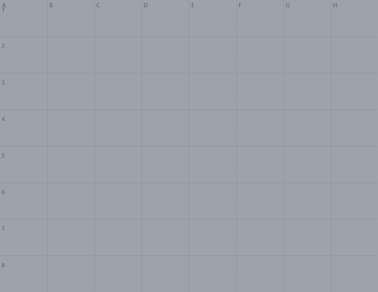
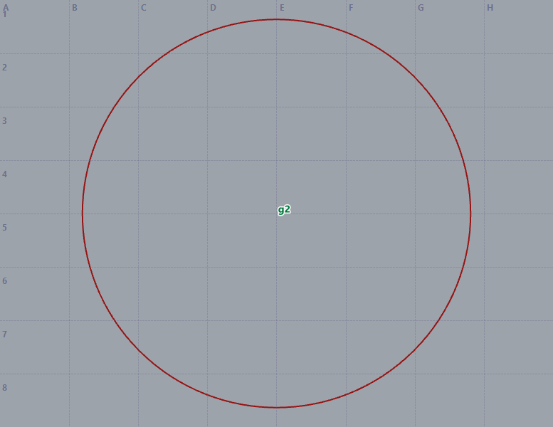
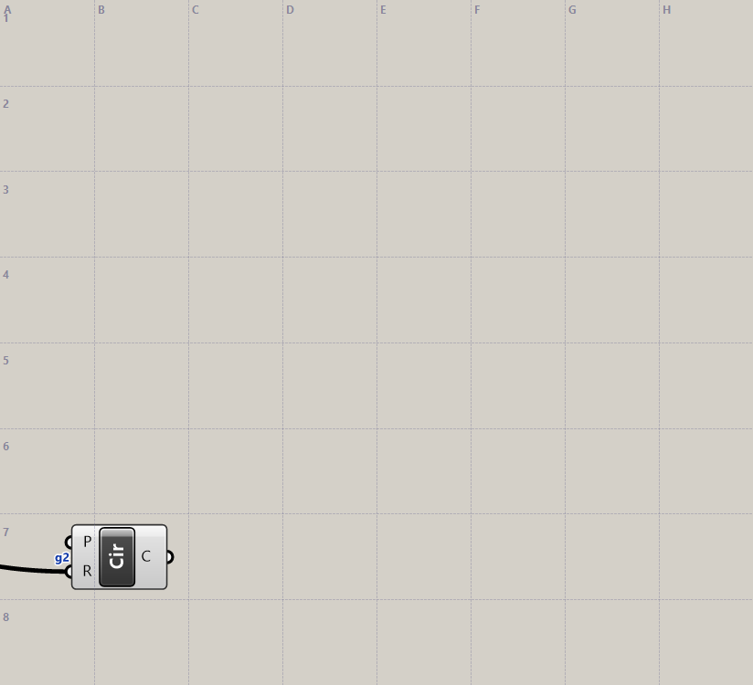
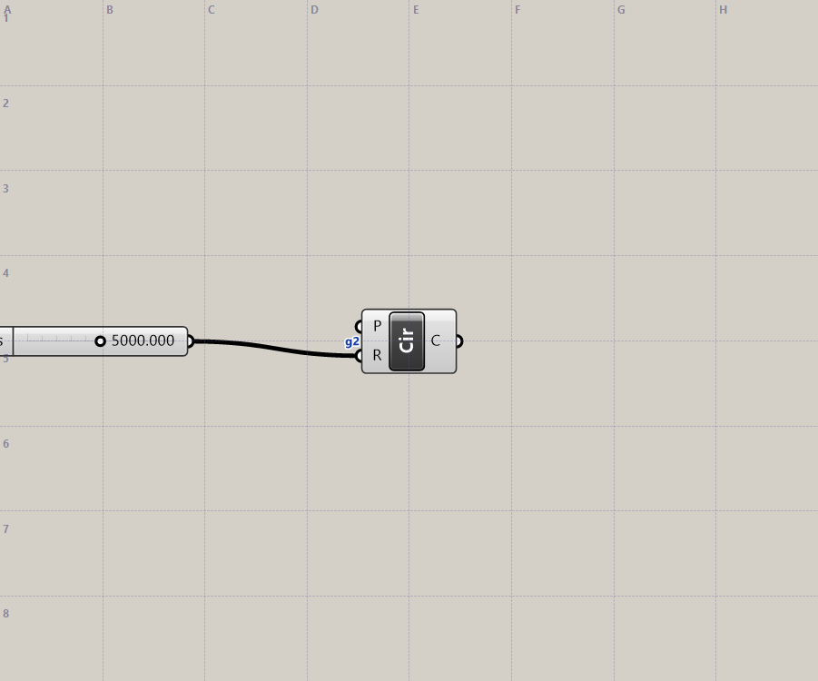
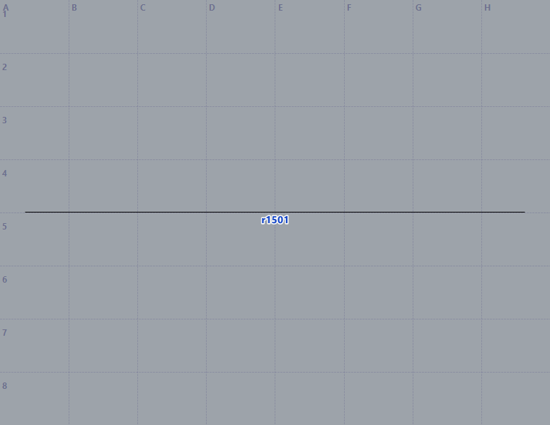
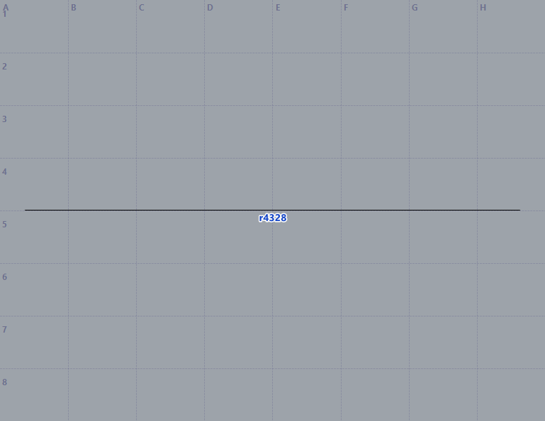
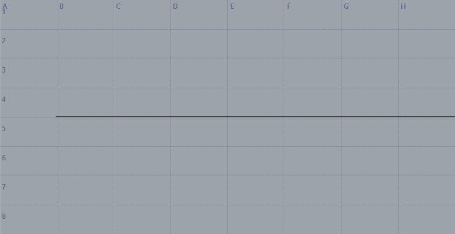
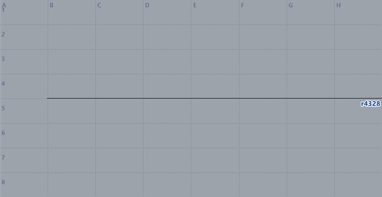
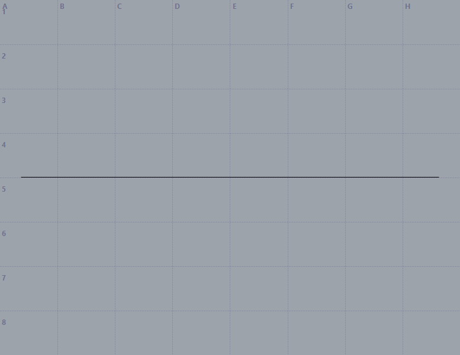

# Tool audit and repair — 2026-10-13

This audit follows the live findings from 2026-10-12 and the request to recheck the development plan, repair confirmed problems, exercise all six tools, show visual evidence, and push focused commits. The source and generated plugin remain version 0.1.2; this work updates Git source and local test builds, without publishing a new Yak or GitHub release.

## Design and reference material reviewed

- [Original plan](../Nextra.zero_RhinoGh_Plan.md): six tools, short handles, automatic checkpoints, region focus, capture restoration, loaded-component lookup, and recoverable errors.
- [Build checklist](../BUILD_PLAN.md), [tool contract](../03_tools.md), [internals](../05_internals.md), and [development workflow](../06_workflow.md): implementation responsibilities and live verification gates.
- [Earlier Rhino view code](../reference/rhino_tools/vision_utils/core_view.py) and [capture code](../reference/rhino_tools/vision_utils/vision_capture.py): separate camera/CPlane ownership and use factual text alongside visual evidence. These are reference material; their larger tool surface was not copied into Nextra.
- [Plugin packaging guide](../07_plugins_and_marketplaces.md): update owning sources, regenerate `plugin/nextra-rhinogh`, and verify packaged startup and source synchronization.

## Findings and changes

| Issue | Reproduction / evidence before repair | Change | Verification |
| --- | --- | --- | --- |
| Ask mode allowed direct editing calls | `NEXTRA_MODE=ask` listed only view/query, but `tools/call` with `name:run` executed `print('ask bypass')`. | `callTool` checks the exposed tool allowlist before forwarding. Ask mode also rejects `query` with `dismiss_dialog:true`. | Actual stdio call rejected; deterministic bridge tests verify that denied requests never reach HTTP. |
| Implicit instance selection was not sticky | `serverInfo()` returned the sole instance without setting `BOUND`; another sole instance could be selected later. | Automatically selecting one instance now pins its PID. Explicit `instance` still permits rebinding. | Simulated discovery: first instance selected, first disappears, second appears → refusal; explicit rebind succeeds. |
| Heartbeat could consume delayed results | Bridge heartbeat called `query scope:status`, while host status clears its late-result queue. The heartbeat discarded its response. | Heartbeat uses `/health`, which updates client activity without draining late tool output. | Bridge test verifies `/health`; live timeout case delivers `late done`. The exact timing of the original missing late result was not established. |
| Dialog dismissal could target an intermediate window | Original live case reported closing a `WindowsForms10...` window while the named `Nextra test` dialog remained open, blocking later cases. | Follow disabled owner/popup chains to an enabled popup in the Rhino process. After closing, rescan blocking dialogs before claiming success. | Updated host closes `Rhino 8 Nextra test` on the first dismiss call; the next status reports idle. |
| GH handle/cell ambiguity | `focus:'g2'` matched the case-insensitive grid-cell pattern and cropped cell G2. This affected both GH canvas and GH preview. | Lowercase single `g1`–`g8` means a GH handle; uppercase `G1`–`G8` means a grid cell. Cell ranges remain unambiguous. | Fresh GH document: both canvas focus and preview focus identify the one component. Before/after images below. |
| Capture changed viewport state | `view:'right'` changed the viewport name; a previous check also observed a changed target. Named-view restoration occurred before the snapshot. | Snapshot before applying a named view. Restore projection, name, camera target, construction plane, and display mode in `finally`. | Before/after camera equality check passes after a standard projection capture. |
| Visible geometry omitted from cropped counts | A long line crossed crop `A4:C5`, but its bounding-box centre was outside. The reply said `0 objects in frame` and provided no handle. | Use projected bounding-box intersection for frame inclusion and cell query selection. | Same crop reports and tags one line; `query filter:'cells:A4:H5'` finds it. |
| Tags-off produced a false crowd warning | With one object and `tags:'off'`, reply said `Too many to tag (1 > 30)`. | Crowding advice is emitted only for automatic tags that exceed the limit. GH handles are also retained in unplaced-tag diagnostics. | Tags-off capture succeeds without the false warning. |
| Documented plane literals parsed as node IDs | `Circle (P=XY, R=n)` or `g2 (P=XY)` returned `unknown id 'XY'`. | Recognize reserved uppercase `XY`, `XZ`, and `YZ` before parsing general wire references. | Atomic edit with `P=XY` succeeds and produces a circle. |
| Fuzzy search manufactured unrelated matches | `divde curve` returned Curve and `.C#`; `zzzxxyy_no_component` returned `.C#`. A builtin category bonus also gave unrelated entries positive scores. | Require name/word/description evidence before applying a category preference; rank close spelling matches with edit distance. | Divide Curve ranks first for the typo. Nonsense query reports nothing found. Exact Loft/Divide Curve ports and the installed Karamba3D category still work. |
| Layer changes were not undone | Layer-only edits returned no checkpoint. Undoing a point on a newly created layer removed the point but left the layer. Bake created its layer before tracking began. | Snapshot layer JSON, IDs, indices, CRCs, and the current layer. Include layer changes in delta emptiness and checkpoint completion. Restore original layers before objects, then remove added layers. Start bake tracking before layer creation. | Layer-only, object+layer, rename/colour, nested/current-layer, and bake-layer undo checks pass. |
| Regression isolation was incomplete | `fresh_memory` redirected learned memory but left user workflows/guides in the real user folder. | Also redirect `user_dir` into the test run folder and restore the previous config values on exit. | Full suite exercises workflows/guides inside `_mem/run-.../user`; final configuration restoration checked. |
| Missing-file test inherited a PID pin | During the first new full run, an explicitly nonexistent `NEXTRA_FILE` was masked by the inherited `NEXTRA_PID`. This produced 238/239, although the bridge correctly gives PID selection precedence. | The test subprocess clears inherited `NEXTRA_PID` when explicitly testing a file selector. | Corrected full suite passes. This was a test fixture issue, not a bridge selection failure. |

## Visual evidence

The images are actual Rhino/GH captures from the same controlled test cases. Before captures use the original code; after captures use the repaired engine. Handle numbers can differ between sessions.

### GH preview focused on `g2`

Before: the handle was interpreted as a grid cell, leaving a blank crop.



After: the circle is framed and tagged `g2`.



### GH canvas focused on `g2`

Before: the reply described a cell region. The image could still contain the component by coincidence, so the text and framing contract mattered.



After: the reply identifies focus on one object and the component is centred in context.



### Long line overview and cropped region

The full line was visible in both versions:





Before crop: visible line segment, but the reply reported zero objects and supplied no tag.



After crop: the reply reports one object and the segment has its handle tag.



### Tags deliberately disabled

The bitmap should have no tags in both versions. The repaired behavior is in the accompanying text: the false `Too many to tag (1 > 30)` warning is gone.




## Verification and tool coverage

| Tool / subsystem | Checks |
| --- | --- |
| `view` | Rhino projections, layer/handle/cell focus, cropped long geometry, automatic crowding, GH canvas, GH preview, tags off, isolation, restoration. Before/after captures manually inspected. |
| `query` | Summary/list/detail/vertices/data, exact filters, cell selection, docs and API lookup, missing docs, loaded component ports/categories, typo/no-match search, status, instance refusal. |
| `run` | Python/C#, code and patch, file and Python library execution, partial error reporting, object deltas, GH fallback, timeout/late result, layer checkpoints. |
| `gh_edit` | Creation/editing/wires/groups, script components, menu/click state, partial errors, atomic rollback, layout/relays, bake, open/save, `.ghs` identity and Rhino references. |
| `undo` | Added/deleted/transformed objects, GH slider state, named checkpoint and steps, bake-created layers, layer-only edits, renamed/coloured and nested/current layers. |
| `memory` | List, preference replacement, mistakes/compact, rules size cap, script save/read/delete, workflow/guide save/read, isolated test directories. |
| Packaging | Both plugin ZIPs and agent kit: paths, manifests, integrity, source synchronization, MCP initialize and six tools. |

Recorded runs:

- Original focused audit: **10/21 passed**, demonstrating the failures above.
- Repaired focused audit: **25/25 passed** before the final cleanup assertion was added.
- First full run after host restart: **238/239**, with only the inherited-selector fixture failure.
- Corrected full run: **239/239**.
- A second corrected full run in the same session and the final focused run are recorded in the completion section below.
- `Nextra.Engine` and `Nextra.Host` Debug builds pass. Bridge syntax and deterministic bridge checks pass. Plugin archive verification passes.

Reproduce with an empty Rhino document and empty active GH canvas:

```powershell
python tools/build.py Nextra.Engine Nextra.Host
node test/regress/bridge_checks.js
python test/regress/edge_cases.py after
python test/regress/regress.py
python tools/make_plugin.py
python tools/verify_plugin.py
```

`nx.py` talks HTTP directly. The bridge checks and the regression's bridge case separately exercise the MCP layer. Host changes require deploying the rebuilt `.rhp` and restarting Rhino; rebuilding only the engine will not test a changed dialog probe.

## Practical limits

- These checks establish the tested behavior, not perfection across every installed plugin or arbitrary model.
- Frame and cell inclusion uses projected bounding boxes. This prevents missing long geometry, but can conservatively include an object whose bounds overlap an otherwise empty part of a crop.
- Undo now includes Rhino object geometry/attributes, layers/current layer, and GH document archives. Arbitrary script effects on files, document settings, materials, or other tables are outside this checkpoint contract. GH open/new/save are document/file actions rather than edits to an archived existing definition.
- A layer containing later user-created objects cannot safely be removed during undo. The operation reports the conflict rather than silently deleting those objects.
- Component search uses the currently loaded ComponentServer. The exact supported ports are authoritative; fuzzy results remain suggestions. Plugins that fail during construction can still return `ports unavailable`.
- Existing MCP client processes keep their loaded JavaScript. The generated bridge is updated in the repository and archives; restart/reload an installed client to use that bridge.

## Completion and commits

Completed verification:

- Full regression passed **239/239** and then **239/239 again in the same Rhino session**. The second run checks that handle, archive, plugin-guide and cached state remain usable.
- Final edge audit passed **26/26**, including the cleanup assertion and an actual construction-plane equality check. [Assertion results](evidence/tool-audit/after-checks.json); [original failing assertions](evidence/tool-audit/before-checks.json).
- [Retained full regression summary](evidence/tool-audit/full-regression.md).
- Both projects build; JavaScript syntax, deterministic bridge checks, Python compilation and generated plugin/archive verification pass.
- The final active Rhino model has zero objects, only the Default layer, millimetre units, and an empty active GH definition. Temporary learned-memory and user-docs overrides are removed from configuration. The pre-existing untracked `.agents/skills/` folder is excluded from the commits.

Changes were committed and pushed to `origin/main` in these steps:

1. **`8a4421b`** — Enforce bridge read-only access and preserve instance binding. Includes source/generated bridge and deterministic checks.
2. **`910286c`** — Repair framing, component lookup, layer undo and dialog recovery. Includes engine/host changes, source/generated skill, edge-case audit and regression isolation.
3. **Document reproduced tool issues and verified repairs** — this report, retained evidence/images, and updated README/development/test documentation.

The repository push does not replace an already running MCP client's JavaScript or publish a new release. The updated plugin archives are generated locally in `dist/` and pass verification.
