# Nexiy and the assistant: how to use them

NextraRhinoGh puts **Nexiy**, a small figure, in the bottom-right corner of Rhino. Nexiy shows whether Rhino is connected to
an AI app. Nexiy also opens an **optional assistant panel**: you type a request, and Rhino and Grasshopper change. The
assistant is off until you set it up, and it uses **your own** AI key or AI command-line tool.

The same guide, with more pictures, is on the website:
[Nexiy assistant in Rhino](https://nextra.studio/journal/nexiy-assistant-in-rhino).

- [Nexiy](#nexiy)
- [Clicking Nexiy](#clicking-nexiy)
- [Set up the assistant](#set-up-the-assistant)
  - [API key](#1-api-key)
  - [CLI (your own AI command-line tool)](#2-cli)
  - [Desktop app](#3-desktop-app)
- [Use the assistant](#use-the-assistant)
- [Settings](#settings)
- [Skills, connectors and Nextra Design](#skills-connectors-and-nextra-design)
- [Keys and privacy](#keys-and-privacy)
- [Troubleshooting](#troubleshooting)

## Nexiy

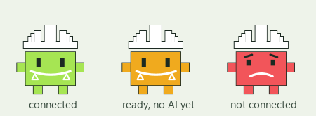

| Nexiy | Meaning |
|---|---|
| green | an AI app (ChatGPT, Claude, a CLI or the assistant) used Rhino in the last 90 seconds |
| amber | ready, no AI app connected yet |
| red, worried | the connection is down. Click Nexiy, then **Restart server** |

Nexiy blinks, falls asleep after a quiet while, and acts a little while the AI works: it types on a laptop, reads, drinks a
coffee, dances. It celebrates when a job is done and cries for a moment when a job fails.

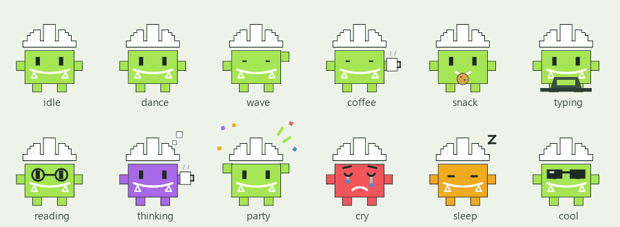

- **Move it:** drag it. The spot is remembered.
- **Size:** Tiny 16 px, Small 24 px (default), Medium 40 px, Large 64 px.
- **Liveliness:** how much Nexiy moves while the AI works.

  | Level | What Nexiy does |
  |---|---|
  | Calm | never moves |
  | Lively (default) | little acts in place |
  | Playful | dances and grows while working |
  | Chaos | runs all over Rhino and the Grasshopper canvas while working |

  Nexiy only moves while the AI is working. When nothing happens, it sits still.
- **Speed:** Slow, Normal (default) or Lively.
- **Hide:** Nexiy's menu, **Hide Nexiy**. To bring it back, run `NextraRhinoGh` and choose **Nexiy > Show**. The same command
  also sets the size.

## Clicking Nexiy

| You | Nexiy |
|---|---|
| **left click**, assistant not set up yet | shows the menu: **Set up the assistant…**, the connection, Size, Liveliness, Speed, Hide |
| **left click**, assistant set up | opens the assistant panel straight away. Click again to close it |
| **right click** | always shows the menu |
| click while the connection is down | shows the menu with **Restart server** |

"Set up" means: a key saved in **API key** mode, or a CLI chosen in **CLI** mode. In **Desktop app** mode you chat in Claude or
ChatGPT, so a left click shows the menu.

The panel grows out of Nexiy and shrinks back into it when you close it (the **×**, Esc, or a click on Nexiy).

*Version 0.2.0 shows the menu on every click; choose **Open assistant** there.*

## Set up the assistant

Click Nexiy, choose **Set up the assistant…**, then the settings button (the sliders, top right of the panel). Under
**Connection**, pick one of three ways:

| Way | Who does the thinking | You need |
|---|---|---|
| **API key** | the AI provider, with your key | an OpenAI, Gemini, Claude or Jev key |
| **CLI** | your own AI command-line tool and its subscription | Claude Code, Codex or Gemini CLI installed |
| **Desktop app** | Claude or ChatGPT on your desktop | the NextraRhinoGh plug-in in that app (see the [README](../README.md#install)) |

### 1. API key

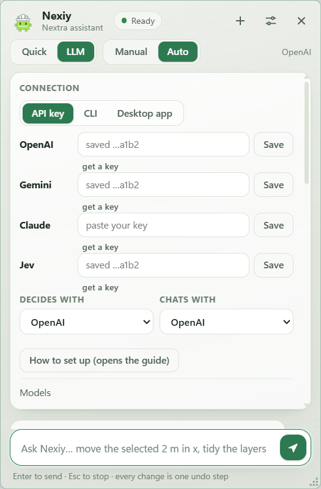

1. Paste a key next to **OpenAI**, **Gemini**, **Claude** or **Jev** and press **Save**. **get a key** opens the provider's
   key page.
2. **Decides with:** the model that picks what to do in Quick mode (OpenAI, Gemini or Jev).
3. **Chats with:** the model for LLM mode and for the parts a decision can't choose (OpenAI, Gemini or Claude). Jev only
   decides; it can't chat.

Which key?

- **One key for everything:** OpenAI.
- **Fastest:** Jev to decide, plus an OpenAI, Gemini or Claude key to chat.
- **Fewest chat calls:** Gemini.

You can also save keys with the Rhino command `NextraDecisionApi`.

### 2. CLI

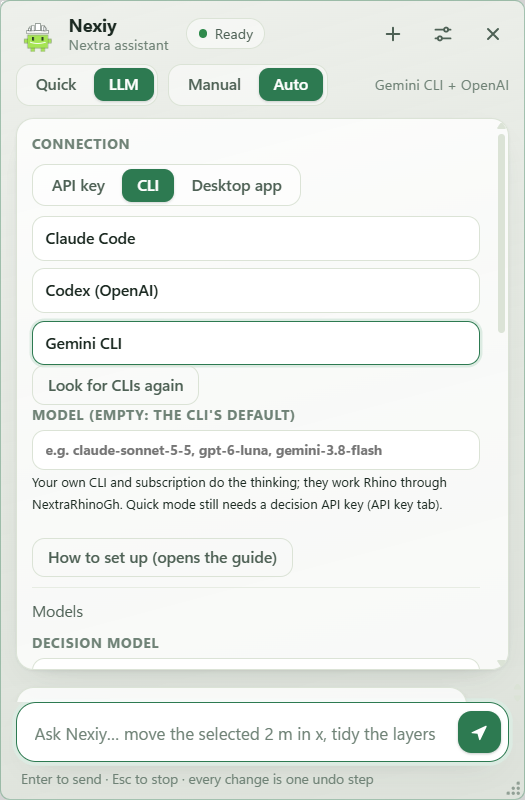

Your own AI command-line tool does the work through NextraRhinoGh, in the same chat panel. No API key is needed for LLM mode:
the CLI uses your own sign-in and subscription.

1. Install one and sign in once in a terminal:

   | CLI | Install | Version |
   |---|---|---|
   | Claude Code | `npm install -g @anthropic-ai/claude-code`, then `claude` and sign in | 2.1.300 or newer |
   | Codex (OpenAI) | `npm install -g @openai/codex`, then `codex login` | 0.170 or newer |
   | Gemini CLI | `npm install -g @google/gemini-cli` | the latest. With a Gemini key saved under API key, the CLI uses that key |

   Update an older one with the same `npm install -g …` command.
2. In the panel: **CLI**, then pick the CLI. **Look for CLIs again** if you installed one with Rhino open.
3. **Model** (optional): empty uses the CLI's default, for example `claude-sonnet-5-5`, `gpt-6-luna` or `gemini-3.8-flash`.

Quick mode still needs a decision key (API key tab). Without one, the panel stays in LLM mode.

### 3. Desktop app

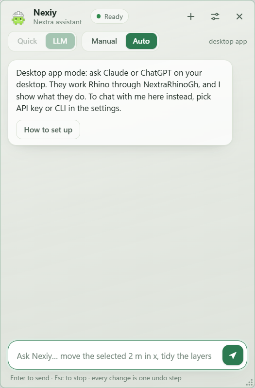

You chat in Claude or ChatGPT on your desktop, with the NextraRhinoGh plug-in installed there. The panel then only shows how
to connect, and Nexiy shows when they work in Rhino.

## Use the assistant

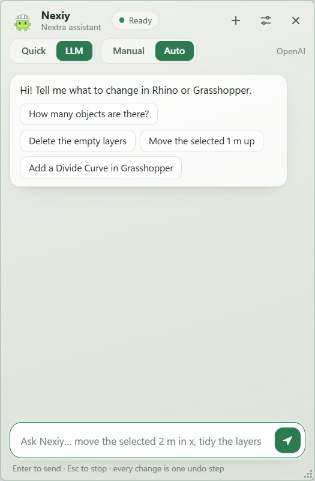

Type a request and press **Enter** (Shift+Enter for a new line). **Esc** stops a running request. Outside the text box, Esc closes the panel.
**+** starts a new chat. Drag the header to move the panel, the corner to resize it.

**Quick or LLM**

- **Quick:** a decision model picks one function from over 60 typed Rhino and Grasshopper functions, then fills in the values
  from what you wrote. Fast (often under a second) and cheap. If a request is really several jobs, Quick hands it to LLM mode.
- **LLM** (default): a chat model works with all of NextraRhinoGh's tools, for open or multi-step work.

**Manual or Auto**

- **Manual:** each change is shown first, with **Apply** and **Discard**.
- **Auto** (default): changes are made at once.

Every change is one undo step, and every answer has **Undo**. **How it was decided** shows the steps: which model, how sure,
how long.

What you can ask:

- about the model: object counts, layers, units, size, length, area, volume;
- select and change: move, copy, rotate, scale, mirror, arrays, delete, join, explode, offset, extrude, union;
- layers and tidying: set layer, colour, lock, isolate, on/off, rename, merge, delete empty layers, sort objects onto layers by
  type, delete duplicates;
- create: boxes, circles, lines, rectangles, column grids, floor slabs, building massings;
- Grasshopper: add a component from everything installed on your computer, wire, set sliders, group, select, tidy the canvas,
  recompute, bake; in LLM mode whole definitions in one go.

Examples:

| Request | Mode | Result |
|---|---|---|
| *Delete the empty layers*, *Delete duplicate objects*, *Tidy up: sort everything onto layers by type* | Quick | 4 empty layers removed, 3 duplicates deleted, 12 objects sorted onto Points / Curves / Solids layers |
| *Build a 4-storey building massing: 5 by 3 columns at 6 m spacing, storeys of 3.5 m, with floor slabs* | LLM | 15 columns and 4 slabs in 13 s |
| *In Grasshopper, build a definition: a circle with a radius slider, divided into 24 points, a vertical line from each point …* | LLM, Claude Code CLI | the definition grouped and tidied, 24 lines baked, 17 s |

| Tidy-up in Quick | A massing in LLM mode | Grasshopper with Claude Code |
|---|---|---|
| 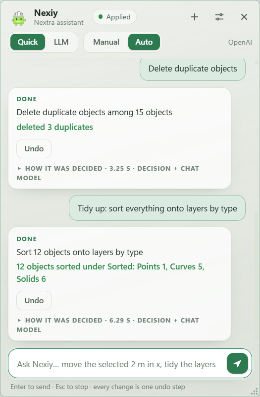 | 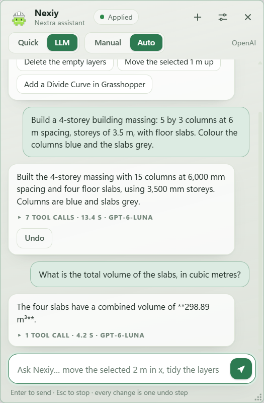 | 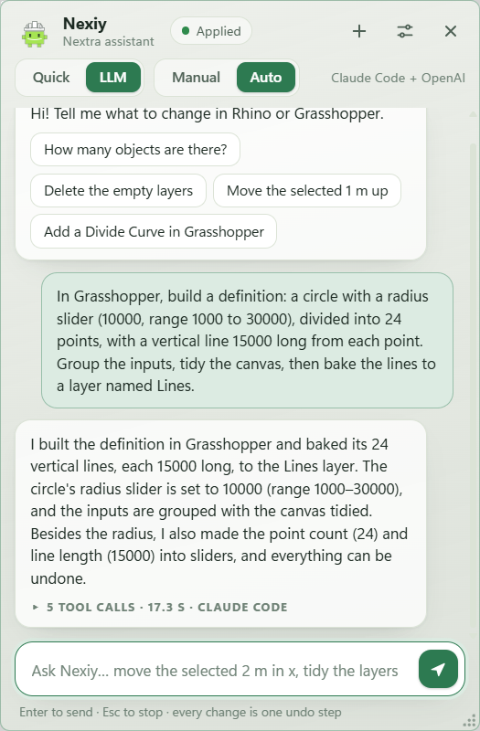 |

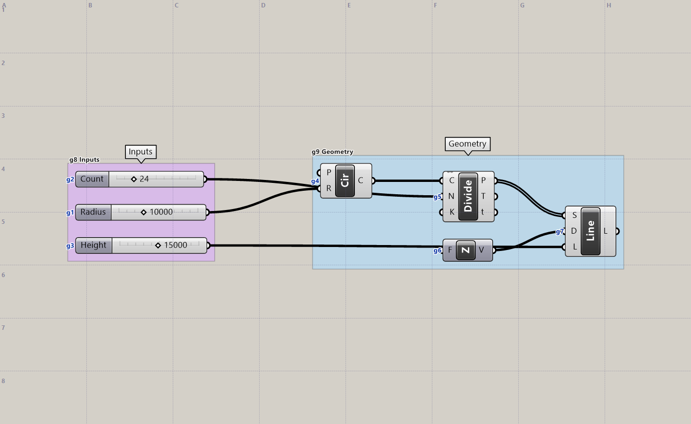

## Settings

The settings button (sliders icon) opens the settings. They scroll.

- **Connection:** API key, CLI or Desktop app (above).
- **Models:** the decision model and the chat models.
- **Decide at:** how sure the decision model must be before Quick acts (default 0.60). Below that, it asks you.
- **Nexiy liveliness** and **Nexiy speed:** as in Nexiy's menu.

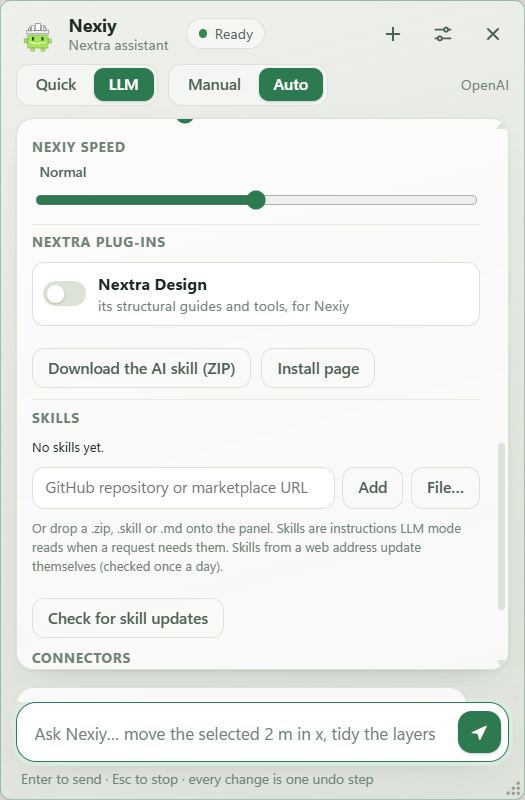

## Skills, connectors and Nextra Design

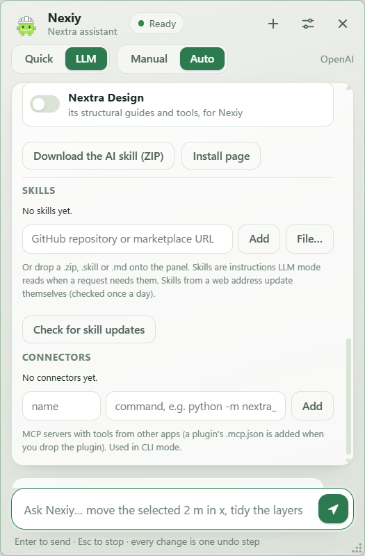

- **Skills** are instructions LLM mode reads when a request needs them. Add one by a GitHub repository or marketplace URL,
  with **File…**, or drop a `.zip`, `.skill` or `.md` onto the panel. Skills from a web address update themselves (checked once
  a day); **Check for skill updates** checks now. Switch a skill on or off, or remove it with ×.
- **Connectors** are MCP servers with tools from other apps (name + command). Dropping a plug-in with a `.mcp.json` adds its
  connector. Connectors are used in CLI mode.
- **Nextra Design** (off by default): switch it on and Nexiy gets Nextra Design's structural guides and tools, from the official
  skill at [nextra.studio/tools/design/install](https://nextra.studio/tools/design/install). It updates itself.
  **Download the AI skill (ZIP)** gets the same skill for your own AI app; **Install page** opens the install guide.

## Keys and privacy

- Keys are stored by your operating system: Windows encrypts them for your user account, a Mac keeps them in the Keychain.
- A key goes only from your computer to the provider it belongs to. It is never written to logs, to the model, to Nextra or
  to the page.
- The panel shows only the last 4 characters of a saved key.
- In CLI mode the CLI uses its own sign-in. Your requests go to that CLI's provider, as when you use it in a terminal.

## Troubleshooting

| Problem | Fix |
|---|---|
| Nexiy is red | Click it, **Restart server**. |
| Nexiy is gone | `NextraRhinoGh` > **Nexiy** > **Show**. |
| A click shows the menu, not the panel | The assistant isn't set up yet: choose **Set up the assistant…** and save a key or pick a CLI. |
| Quick is greyed out | No decision key (OpenAI, Gemini or Jev) saved, or Desktop app mode. |
| A key is refused | Check it at the provider (billing, rights for the model), paste it again and **Save**. |
| The CLI isn't found | Install it, sign in once in a terminal, then **Look for CLIs again**. On a Mac, restart Rhino after installing. |
| Gemini CLI says the model is retired or the login isn't eligible | Update the CLI, and save a Gemini key under **API key**: the CLI then uses that key. |
| Ctrl+C / Ctrl+V do nothing in the panel | Fixed in 0.2.1: Rhino took the keys as its own Copy / Paste. Update the plug-in. |
| Nexiy freezes while a long script runs | Rhino is busy; Nexiy moves again when it's done. |
| Nexiy is in the way | Make it Tiny, set Liveliness to Calm, or hide it. |
